# MindRise Entity Relationship Diagram

```mermaid
erDiagram
  users ||--o| profiles : has
  users ||--o{ verification_challenges : verifies
  users ||--o| verified_identities : identifies
  users ||--o{ identity_access_log : actor_or_target
  users ||--o{ assessment_attempts : completes
  assessment_types ||--o{ assessment_versions : versions
  assessment_versions ||--o{ assessment_questions : contains
  assessment_versions ||--o{ assessment_attempts : scores
  assessment_attempts ||--o{ assessment_answers : stores
  assessment_questions ||--o{ assessment_answers : answered_by
  assessment_attempts o|--o{ crisis_flags : may_raise
  community_posts o|--o{ crisis_flags : may_raise
  community_comments o|--o{ crisis_flags : may_raise
  users ||--o{ crisis_flags : flagged_user
  users o|--o{ crisis_flags : assigned_moderator
  users ||--o{ user_goals : sets
  routines o|--o{ user_goals : inspires
  users ||--o{ routine_completions : completes
  routines o|--o{ routine_completions : tracks
  user_goals o|--o{ routine_completions : fulfills
  users ||--o{ user_streaks : earns
  users ||--o| user_stats : tracks_overall_progress
  routines ||--o{ user_streaks : tracks
  users ||--o{ user_badges : receives
  badges ||--o{ user_badges : awards
  users o|--o{ community_posts : authors
  community_spaces ||--o{ community_posts : contains
  community_posts ||--o{ post_reactions : receives
  users ||--o{ post_reactions : reacts
  community_posts ||--o{ community_comments : contains
  users o|--o{ community_comments : authors
  community_comments o|--o{ community_comments : replies_to
  users o|--o{ content_reports : reports
  users o|--o{ content_reports : reported_account
  community_posts o|--o{ content_reports : reported_post
  community_comments o|--o{ content_reports : reported_comment
  users o|--o{ content_reports : assigned_moderator
  users o|--o{ moderation_actions : moderator
  content_reports o|--o{ moderation_actions : resolved_by
  users ||--o| user_settings : configures
  users ||--o{ notifications : receives
  help_resources {
    uuid id PK
    text contact_phone
    text language_code
    text region
  }
```

`verified_identities` is the sole table for real names and contact details. `identity_access_log` records authorized reads. Assessment answers are personal data and cascade with their attempt. Content reports retain internal reporter IDs for moderation but public serializers must never expose them. Crisis flags form a safety queue separate from content reports; references to purged source content may be nulled. `community_spaces` owns the topic catalog, and reactions are removed with their post or account.

`help_resources.contact_phone` is a public resource-provider contact, not a user's phone number. Migration 008 renames the original `help_resources.phone` column so schema audits can distinguish provider contacts from user identity; the value is preserved by the column rename. `verification_challenges` intentionally has no destination column: OTP requests resolve an existing contact through `verified_identities`, while contact-change verification/resend requests must resupply the pending destination and keep it transient until verified. Challenges already in flight at migration time retain their hash/expiry and can still be verified with the delivered code, but resending requires the destination to be supplied again.

Migration 015 adds `password_changed_at` (timestamptz) to `users`. Any access token whose `iat` timestamp precedes `password_changed_at` is rejected by authentication middleware, ensuring password resets immediately invalidate all preexisting active sessions across devices (SRS FR-1.8).